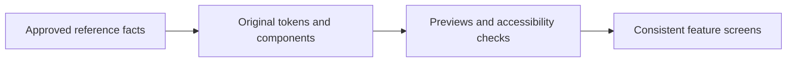
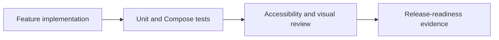
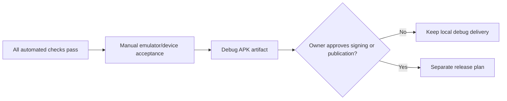
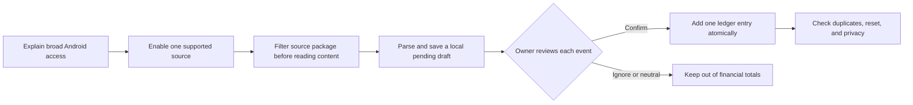
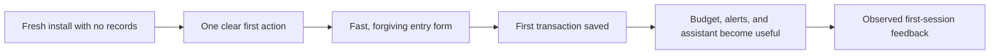
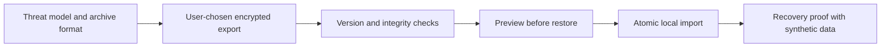

# GOALS — Pierre-inspired Android finance companion

**Execution status:** in progress. The baseline is an offline local ledger. GOALS 9 below is a narrow scope extension: optional, user-enabled, on-device import of financial notices from one selected app (Rico initially). It does not authorize direct bank APIs, credential scraping, network transmission, publication, or production signing.

## Product decision recorded

Build a **greenfield, native Android demo** inspired by Pierre's financial overview, conversational assistance, and proactive insights, under the user's own **wallet Manager identity**. On 8 October 2026 the user authorized use of the wallet Manager logo and palette. The release label is **wallet Manager**; the package identifier remains pending. Do not copy Pierre assets, brand, or text.

The baseline release is an **offline APK** with a manually maintained ledger. GOALS 9 intentionally adds a consent-based path for real notices from the owner's selected app; imported values stay local and do not enter totals until the owner confirms them. The app must not ask for banking credentials, connect directly to Open Finance, claim a banking partnership, trigger WhatsApp, perform payments, make investment recommendations, or describe unconfirmed notices as ledger entries.

The user chose an original presentation based on the wallet Manager assets in `D:\ProjetosPessoais\Logo\apps`. Use `wallet-logo.svg` and `wallet-icon.svg` as reference; record source paths and adapt the system to Android. Final visual acceptance requires a rendered Android build reviewed by the owner.

## Evidence and constraints used for this plan

- `REPERTOIRE.md` documents the public Pierre catalog: Open Finance aggregation, conversations through app/web/WhatsApp, agents, budget/reporting, a CDB offering, and the future Pierre One/Computer products.
- Pierre’s public terms describe the service as informational support rather than professional financial, investment, legal, accounting, or tax advice. This plan preserves that boundary.
- Android’s current official guidance is Compose-first, recommends screen-level `ViewModel` plus `StateFlow`, and provides first-party Compose UI tests. [Compose-first](https://developer.android.com/develop/ui/compose/first) · [architecture](https://developer.android.com/topic/architecture/recommendations) · [Compose testing](https://developer.android.com/develop/ui/compose/testing)
- For new Google Play submissions after 31 August 2026, Google’s current policy requires target Android 16 / API 36 or higher. The target must be rechecked just before any release. [Google Play policy](https://support.google.com/googleplay/android-developer/answer/11926878)
- Android’s `NotificationListenerService` can receive posted notifications with their source package, and Android requires the user to grant notification access. That grant is broad, so the app must disclose it and immediately discard notices whose package is not the one selected in the app. [Notification listener API](https://developer.android.com/reference/android/service/notification/NotificationListenerService) · [Android 15 compatibility requirements](https://source.android.com/docs/compatibility/15/android-15-cdd)
- XP’s developer portal describes its APIs in a partner context, and its Open Finance documentation is directed at Open Finance participants. GOALS 9 therefore uses local Android notices for the first integration instead of assuming a self-service personal API. [XP developer portal](https://dev.xpinc.com/) · [XP Open Finance documentation](https://developer.xpinc.com/open-finance)
- Android’s security guidance requires least privilege and keeping sensitive information out of shared/external storage. The baseline remains fictional/local; GOALS 9 may handle only user-approved local notices and must keep them out of logs and external storage. [Android security checklist](https://developer.android.com/privacy-and-security/security-tips)

## Out of scope for the baseline and GOALS 9

- Copying or impersonating Pierre, CloudWalk, InfinitePay, any bank, or WhatsApp.
- Direct Rico/XP API or Open Finance integration, credential-based scraping, payment initiation, card issuance, brokerage/CDB execution, and a production chatbot. GOALS 9 covers only a local Android notification listener for one explicitly selected, supported source app; it does not access bank/card systems or import account history.
- User accounts, cloud sync, analytics, advertising SDKs, personal data collection, remote API keys, and Google Play publication.
- Importing notifications from every installed app, multiple financial sources in the first release, iOS, web, smartwatch, shared-family accounts, and multi-currency operation.

# GOALS 3 — Build the wallet Manager design system before screens

Suggested: gpt-5.6-sol · high — visual fidelity depends on many interacting layout, typography, state, and motion decisions rather than a single screen implementation.

- [x] G3.1 — Implement wallet Manager-derived tokens for color, elevation, spacing, corner radius, typography, icon sizing, motion, and semantic states (success, warning, critical, neutral). Use accessible contrast, reuse the user-authorized wallet Manager mark, and do not reproduce Pierre’s assets or text. **Done when:** tokens power every component preview and a light/dark decision is intentional; the default demo mode uses the approved forest-green theme.
- [x] G3.2 — Create reusable Compose components: app scaffold, greeting/header, amount row, status pill, transaction row, insight card, chart container, assistant bubble, loading skeleton, error notice, empty state, bottom navigation, and confirmation sheet. **Done when:** each component has normal, loading, empty, error, and disabled states where relevant, plus `contentDescription`/semantics when it conveys information.
- [x] G3.3 — Define motion tokens with a reduced-motion preference: brief press feedback, list/card entry, number transition, and sheet movement, all interruptible and optional. Avoid decorative animation that delays a financial value or status. **Done when:** animations respect a disabled/reduced-motion setting and no screen relies on motion alone to communicate state.
- [ ] G3.4 — Produce Compose previews for 360dp and 412dp phones, large font, dark mode, empty/loading/error states, and a long Portuguese currency value. **Done when:** no important amount, label, action, or navigation control clips in the specified previews.
- [ ] G3.5 — Perform a manual comparison against the owner-approved screenshots and record differences as intentional original-brand decisions or defects. **Done when:** the owner signs off on a side-by-side state-by-state comparison; source/build success alone is not accepted as visual proof.

# GOALS 7 — Establish quality, accessibility, and privacy proof

Suggested: gpt-5.6-sol · high — regression proof must cover calculation rules, state restoration, navigation, and accessible financial information rather than only a successful build.

- [x] G7.1 — Add unit tests for repositories, budget calculations, category correction, alert rules, assistant intent parsing, unsupported-intent response, and reset behavior using fakes rather than external services. **Done when:** all calculations have representative normal, boundary, empty, and invalid-state assertions.
- [x] G7.2 — Add Compose UI tests for onboarding disclosure, dashboard period change, transaction filtering/detail, budget update, alert dismissal/reopen, assistant supported/unsupported prompt, settings persistence, and reset confirmation. **Done when:** the instrumented suite passes on the documented emulator/API level.
- [ ] G7.3 — Add screenshot/regression testing only after the owner approves the wallet Manager visual baseline; never place Pierre screenshots or assets in test fixtures. **Done when:** approved Android screenshots cover dashboard, transaction list, assistant, large font, and dark-mode edge cases.
- [ ] G7.4 — Audit TalkBack semantics, focus order, touch target size, dynamic type, color contrast, localized Brazilian currency/date formatting, no-color-only warning states, and reduce-motion behavior. **Done when:** manual TalkBack walkthrough and automated semantics checks pass for every bottom-navigation destination.
- [x] G7.5 — Run dependency, secret, and permission reviews: no network permission unless an approved later feature needs it; no storage/contact/SMS/phone permission; no analytics; no tracked personal data; no hard-coded key. **Done when:** manifest and dependency review confirm the permission/data-minimization policy and any exception has an owner-approved reason.
- [x] G7.6 — Configure one repeatable local/CI-quality command sequence for formatting, static analysis, unit tests, instrumented tests, and debug APK assembly. **Done when:** commands return meaningful non-zero failures and are documented in the README.

# GOALS 8 — Produce the APK and retain human release gates

Suggested: gpt-6-astra · xhigh — APK signing, distribution, developer verification, and any financial-data expansion are external, security-sensitive approval gates.

- [ ] G8.1 — Assemble a debug APK after all quality checks pass; record its application ID, version name/code, SHA-256 checksum, build command, and tested device/emulator API level. **Done when:** the artifact installs and the complete MVP acceptance flow is manually exercised on a physical device or Android emulator.
- [ ] G8.2 — Perform a manual visual acceptance against the wallet Manager identity and approved Android baseline at the recorded device size. **Done when:** the owner confirms that the wallet Manager symbol, color/style continuity, clarity, information density, and conversation-led flow are achieved without Pierre branding.
- [ ] G8.3 — Keep release signing, developer identity verification, Play Console setup, store listing, privacy/data-safety declarations, support channel, terms, and publication **out of execution** until separately authorized. **Done when:** release work has its own approved plan, signing key custody owner, and verified current Google/Android policy requirements.
- [x] G8.4 — Keep direct Open Finance, WhatsApp, and other remote financial integrations outside the demo without a separate human-in-the-loop discovery and compliance plan covering provider contracts, consent flow, backend security, LGPD roles, incident response, authentication, data deletion/export, financial disclosures, and end-to-end device testing. **Done when:** no code for these remote integrations has been started under the demo scope; the narrowly scoped local notification import is tracked separately in GOALS 9.

# GOALS 9 — Import one selected financial app’s notices into a confirmation inbox

Suggested: gpt-6-astra · xhigh — the highest-risk work combines broad notification permission, sensitive financial text, database migration, and duplicate-safe ledger writes.

- [x] G9.1 — Keep v1 limited to Android notification import from one explicitly selected and supported source app, initially Rico. In Settings, explain that Android grants broad notification access while wallet Manager filters by the selected app package before reading or storing notification content. Where notices reliably identify a linked account/card/feed, let the owner choose the intended feed and discard explicitly non-selected-feed notices before persistence; an ambiguous feed must never be assigned automatically and stays outside totals until clarified. Confirm that there is no Rico API, Open Finance, credential collection, background network transfer, SMS access, or screen scraping. **Done when:** source/feed boundaries, consent text, unsupported-source behavior, and data lifecycle are documented in `README.md` and `ACCEPTANCE.md`, with the Android/XP evidence above linked.
- [ ] G9.2 — Add a source picker that lists only explicitly supported apps (Rico initially), permits exactly one active app, and shows a user-controlled connection state and permission status in Settings. Allow a feed/account/card filter only when a supported notification pattern exposes a reliable identifier; never ask for or store full account/card numbers. Declare the `NotificationListenerService` with Android’s required bind permission/action, provide a clear route to Android’s notification-access screen, recheck after returning, and allow pause/disconnect. Verify Rico’s exact package identifier on the owner’s installed app during implementation rather than guessing or scanning all installed apps. The listener must check the callback package before reading notice content; for the selected app, it may parse only the minimum fields needed to recognize a configured feed, then discard explicitly non-selected feeds before persistence or logging. **Done when:** denied, revoked, disabled, disconnected, unsupported, source-not-installed, and ambiguous-feed states are visible; a labeled non-selected feed is discarded before it reaches app storage or logs.
- [ ] G9.3 — Add a Room v3-to-v4 migration for a separate pending-notice inbox and the minimum event identity/status metadata needed for idempotency. Keep unconfirmed drafts out of ledger queries and totals. Store only the selected source and the fields required for review; do not persist full notification payloads, card/account numbers, authentication codes, or unrelated text, and do not log financial content. Preserve existing transactions and preferences through migration. A full app reset must clear pending drafts and their deduplication metadata; disconnecting must stop capture and offer to discard or keep pending drafts without deleting confirmed ledger entries. **Done when:** migration, reset, disconnect, and data-minimization behavior have automated persistence tests.
- [x] G9.4 — Parse a bounded set of notification events into explicit types: purchase/charge, incoming money, card-bill payment, internal transfer, refund/reversal, and unknown. Interpret purchase as a proposed expense and incoming money (including supported Pix receipt notices) as a proposed income. Card-bill payments and transfers must not create a second expense or change totals. Refunds/reversals must remain reviewable and must not silently become income; link to the original transaction when confidently possible. Declined/pending authorizations, OTP/security notices, promotions, and unparseable messages must not become ledger entries. Handle Brazilian currency separators, date ambiguity, missing/truncated/grouped notification text, locale/time-zone fallback, foreign currency, edited/reposted notices, and contradictory amounts conservatively; uncertain values stay pending for correction. For installments, use only an amount explicitly labeled as the current charge/first installment; if the notice gives a total purchase and installment count without an unambiguous current charge amount, require the owner to enter/confirm the amount before confirmation. Never multiply the notice amount or generate future installment rows automatically. **Done when:** deterministic parser fixtures cover each event class and boundary, including explicit installment amount and ambiguous total/count cases, with no unrecognized notice auto-imported.
- [ ] G9.5 — Add a dedicated “Importações pendentes” review inbox reachable from Extrato and a pending count, while keeping reconciliation of saved transactions separate. Each draft must show source, event type, observed date, amount, merchant/description, and a suggested category when available; let the owner edit fields, choose/confirm a category from the existing categories, confirm, ignore, or mark a suspected duplicate. Require explicit confirmation per financial event and a category decision for each expense; do not change income, expense, balance, budget, or insight totals before confirmation. Make the source and access state understandable when the inbox is empty or permission is unavailable. **Done when:** the example of a card bill payment, a bakery purchase of R$ 8,89, and a separate part purchase yields one neutral item and two individually confirmable expense drafts with categories; a received-money notice yields a separately confirmable positive income draft.
- [ ] G9.6 — Make ingestion and confirmation idempotent across notification re-delivery, updates to the same Android notification, process death, repeated callbacks, and rapid double taps. Use stable source-event identity where available and a conservative fingerprint otherwise. If an imported notice might collide with a manual ledger entry or another purchase with the same merchant, amount, and date, show a possible-duplicate warning for the owner to decide; never silently discard a legitimate repeated purchase based only on matching amount/merchant/date. Confirming must atomically create at most one ledger row and mark its draft resolved. Removing/dismissing a notice in Android’s notification shade must not erase a pending app draft. **Done when:** replay, concurrent/repeated confirmation, duplicate-candidate, and two-legitimate-identical-purchase cases are covered by tests.
- [ ] G9.7 — Add automated coverage for package and labeled-feed filtering before content handling (including a non-selected linked account/card notice that never enters the inbox), ambiguous-feed review, every parser class and malformed/ambiguous input, both installment amount cases with no generated future rows, repeated and updated callbacks, Room migration with existing data, drafts excluded from totals, income/expense sign and category behavior, neutral bill/transfer events, atomic confirmation, duplicate review, reset/disconnect, and permission denial/revocation. Add Compose coverage for inbox states and each owner action. **Done when:** relevant unit, migration/instrumented, and UI suites pass and demonstrate that only confirmed purchases/income affect totals.
- [ ] G9.8 — Update `README.md`, `ACCEPTANCE.md`, and privacy/permission documentation with setup, consent, source filtering, offline/local storage, supported message patterns, limitations, reset/disconnect behavior, and manual test steps. Validate first with synthetic or redacted fixtures. A live notification test may use only a real purchase the owner already planned or has explicitly approved; do not spend money to generate a test. **Done when:** the owner can enable one source, review expense/income drafts, confirm or ignore them, disconnect, and verify the expected ledger and totals on an emulator/device without any release signing or publication.

# GOALS 10 — Make the first empty session useful in under two minutes

Suggested: gpt-5.6-sol · high — the change crosses onboarding, navigation, empty states, form validation, and the Compose test suite, so a screen-by-screen edit would risk a fragmented first-use flow.

**Design rationale and scope:** A new wallet Manager user must understand the offline value proposition, record one transaction, and see the result without encountering inactive tools or validation errors. The app must keep its local-only promise and its real, empty-data behavior; it must not preload fictional finances, add bank connectivity, collect analytics, or claim that an alert or answer exists before the user has supplied data.

- [ ] G10.1 — Write a first-session state matrix before changing code: no transactions/no budget, transactions/no budget, transactions/with budget, and pending notification imports. Define one primary next action, one supporting explanation, and the visibility rule for every card, filter, and navigation shortcut on Home, Extrato, Planos, Avisos, and Assistente. Reuse `WelcomeScreen`, `HomeScreen`, `TransactionsScreen`, `BudgetsScreen`, `AlertsScreen`, `AssistantScreen`, and `AlluApp`; do not create a second onboarding persistence model when the existing `entered` preference and actual local records are sufficient. **Done when:** a Portuguese-speaking user can follow a documented, no-data path from install to one saved entry without guessing what to tap, and each inactive capability has either a purposeful empty state or is absent.
- [ ] G10.2 — Change the welcome-to-home handoff so the first primary action is “Adicionar lançamento” and opens the manual editor directly. On `HomeScreen`, preserve the balance as context but replace the stack of zero-value charts, plans, insights, and recent-transaction cards with a compact progress cue: first entry, first limit, then use alerts/assistant. Keep a brief “Dados ficam neste dispositivo” disclosure near the first action; move the timestamp/source prose to an on-demand detail or Settings instead of repeating the multi-line banner above every destination. **Done when:** the first viewport on a 384 × 832 dp-equivalent phone shows brand, local-data disclosure, and one unmistakable next action without scrolling, while users with records retain the analytical dashboard.
- [ ] G10.3 — Make each destination progressive rather than displaying controls that cannot yet work. In `TransactionsScreen`, show the create action and a short empty state before filters; reveal search, category, and date filters after at least one transaction, and show the import inbox shortcut only when it has pending items or the user has enabled the supported source. In `BudgetsScreen`, show “Adicionar limite” and an explanatory empty state before the scenario panel; reveal simulation only after a budget exists. In `AlertsScreen`, replace the review card and active/archive switcher with one concise explanation until a review case or alert exists. In `AssistantScreen`, replace answer shortcuts that have no data with the same direct entry action; enable data questions only once they can return a meaningful local result. **Done when:** every empty destination has one useful action and does not expose disabled, misleading, or premature controls.
- [ ] G10.4 — Redesign `TransactionEditor` around a short manual-entry path: amount, merchant, transaction type, category, and a localized date picker/display. Keep the stored canonical date format if repositories depend on it, but present and accept Brazilian `dd/MM/aaaa` values in the UI. Defer field-error text until a field loses focus after input or the user tries to save; aggregate no more than one clear error per invalid field, retain entered values, and keep optional recurrence/installment fields behind an explicit “Mais detalhes” action. **Done when:** an untouched new editor has no error text, an invalid save explains the affected fields without clearing input, and a valid BRL entry can be completed without typing an ISO date.
- [ ] G10.5 — Correct the observed layout and recognition issues while implementing the new states: use `Scaffold` padding/window insets so bottom navigation cannot cover content, retain 48 dp targets, replace symbolic navigation glyphs where they are ambiguous with recognizable Material icons plus the existing labels, and remove duplicated “Visão geral” hierarchy. Test the real 384 × 832 device class, 360 dp and 412 dp widths, large font, light/dark themes, keyboard open, and a long BRL value. **Done when:** no primary action, empty-state message, field, or navigation label clips behind system UI or the bottom bar in the specified states; the semantic label and visible label agree for every tab.
- [ ] G10.6 — Add Compose tests for the state matrix and form behavior: first-action routing, filters and scenario visibility, alert/assistant empty states, localized date presentation, untouched-versus-submitted validation, retained invalid input, and navigation/inset semantics. Add manual device captures for the five empty tabs and the manual-entry form at normal and large font. **Done when:** tests prove the screen conditions through the semantics tree, and the owner reviews the installed-device captures before any visual checklist is marked complete.
- [ ] G10.7 — **Manual validation:** run five consented, Portuguese-speaking first-session walkthroughs using synthetic values only: identify the app’s purpose, add an expense, find it again, create a limit, and explain where data is stored. Record task completion, hesitation, and exact wording that confused participants in an owner-held worksheet; do not add tracking SDKs, transmit finance data, or treat the sample as statistically representative. **Done when:** the owner has reviewed the five session notes and either accepts the flow or opens a follow-up goal for the repeated blockers.

# GOALS 11 — Give local financial data a user-controlled recovery path

Suggested: gpt-6-astra · xhigh — data portability exposes the user’s complete financial history and can destroy or disclose local records if archive cryptography, restore, backup rules, or error handling are wrong.

**Design rationale and scope:** The absence of an export/recovery path is a trust blocker for a local finance app: a user cannot confidently invest time entering history if changing or losing a phone means losing it. This goal adds an owner-controlled, offline archive only. It excludes cloud sync, automatic sharing, account recovery, third-party storage access, bank data, analytics, and any test that touches real financial data.

- [ ] G11.1 — Document the archive threat model and a versioned, minimal schema before implementation. Inventory transactions, limits, goals, display preferences, review/import state, and local-assistant messages; explicitly identify what is excluded, maximum archive size, compatibility policy, cancellation behavior, passphrase loss behavior, and what will happen on duplicate or incompatible records. Use a format-independent envelope with a non-sensitive format version outside protected content and authenticated encrypted payload inside it. Do not invent cryptography, expose key material, or silently rely on Android Auto Backup; the existing manifest/rules intentionally exclude all app data from automated backup. **Done when:** the owner approves a one-page data lifecycle and recovery contract that makes clear which data can be restored, what cannot be recovered without the user-held secret, and that no archive is sent to wallet Manager.
- [ ] G11.2 — Implement explicit export and import through Android’s system document picker, using `ACTION_CREATE_DOCUMENT` and `ACTION_OPEN_DOCUMENT` for a user-selected file rather than broad storage permissions or a hard-coded public directory. Build and validate the archive completely inside app-private temporary storage, then stream to the chosen URI only after the user confirms. Use maintained, authenticated encryption with a user-held secret and tested key derivation; bind the archive type/version as associated data and never store a plaintext copy, passphrase, key, or transaction payload in logs. **Done when:** exporting requires a deliberate user-selected destination, produces no readable financial plaintext in shared storage, does not add a storage permission, and cancellation leaves the current local database unchanged.
- [ ] G11.3 — Implement restore as a guarded preview, never an overwrite on file selection. Validate size, version, authenticated encryption, schema, numeric/date/category constraints, referential integrity, and duplicate policy before displaying only counts and safe summaries. Require an explicit final choice between replace-all, merge-if-supported, or cancel; make the chosen mutation one Room transaction with a rollback-safe failure path. Preserve current data on an unreadable, modified, foreign, outdated, or incompatible archive. **Done when:** malformed, wrong-secret, tampered, oversized, partial, incompatible, and duplicate fixtures cannot modify stored finance data, while a valid archive restores its documented data set exactly once.
- [ ] G11.4 — Recheck device-transfer and cloud-backup rules along with export behavior. Keep automatic Android backup disabled unless a separately approved security review changes the product promise; make manual export the sole, visible portability path. State plainly in Settings that the user chooses the file location and that its protection depends on the export secret and the chosen destination. **Done when:** manifest/rule tests and a Settings review prove there is no implicit backup path and users can locate both export and restore information without searching the privacy copy.
- [ ] G11.5 — Add unit and instrumented tests for archive round trips, version negotiation, encryption/authentication failures, no-plaintext temp cleanup, cancellation, database atomicity, allowed/blocked merge cases, and document-picker result handling. Use synthetic fixture ledgers only; test a recovery path on an emulator or isolated test installation rather than uninstalling or modifying the owner’s actual data. **Done when:** the automated suite proves every negative case preserves the original data and the manual recovery rehearsal recreates a synthetic ledger on a second installation.
- [ ] G11.6 — **Manual security gate:** before enabling this in a release candidate, have the owner review the archive threat model, restored-data behavior, and a source/destination file inspection with synthetic data. Reconfirm the current Android storage, backup, and cryptography guidance at that time, because these are security-sensitive platform dependencies. **Done when:** the owner records approval of the observed recovery flow; release signing, store publication, and cloud backup remain separate decisions.

## Execution order

1. G1 locks the scope, legal/brand limits, original identity, and visual references.
2. G2 makes the Android project reproducible.
3. G3 establishes components and visual acceptance before duplicating screen code.
4. G4 supplies deterministic local data and state.
5. G5 ships the complete, navigable demo.
6. G6 adds differentiated trust and explainability improvements.
7. G10 turns the current ledger into a clear first session before asking a new user to interpret empty analytics, alerts, or assistant prompts.
8. G9 implements the explicitly authorized one-source local notice inbox after the baseline ledger and its first-use flow are coherent.
9. G11 adds a separately reviewed local recovery path after the data inventory and migration surface are stable; it retains its manual security gate.
10. G7 proves baseline, G9, G10, and G11 behavior, privacy, accessibility, and visual quality.
11. G8 produces only a debug APK, retaining signing/publication/remote integration as explicit human approval gates.

## Manual decisions still required before a production release

- The first deliverable remains the offline debug APK. The owner has authorized planning for local notification import from one selected supported source; direct APIs, Open Finance, and other remote integrations still require a separate authorization and plan.
- Confirm the final package ID; the prototype uses `com.example.allufinancas` provisionally.
- Review the installed Android screens against the wallet Manager colors and symbol; owner visual acceptance is still pending.
- Decide later whether to commission a signed internal release. No signing or publication is authorized in this execution.

## Improvement backlog after the MVP

These are product opportunities, not authorized implementation:

1. **Financial data freshness and coverage:** show last successful sync, accounts excluded from a conclusion, and source-level confidence on all insights.
2. **Reconciliation before automation:** let users approve category, merchant and duplicate decisions, with full reversal history.
3. **Explainable simulations:** make every budget scenario reveal arithmetic, assumptions, time period, and what it cannot predict.
4. **Trust center:** one place to inspect permissions, data origins, connected institutions, consent expiry/revocation, deletion/export status, and support contact.
5. **Collaborative budgeting:** a later, consentful household mode with separate identities and clear ownership, instead of shared credentials.
6. **Proactive alerts with restraint:** user-configured thresholds, quiet hours, grouping, and a clear reason for each message rather than high-volume notifications.
7. **Human escalation:** when an insight crosses into tax, legal, credit, investment, fraud, or debt advice, stop at factual explanation and direct the user to an appropriate qualified professional/channel.

## Explicit success definition

The baseline work is complete only when an original-name Android app installs as a debug APK, uses local data, performs the documented navigation/calculation/demo-chat flows, passes the defined static/unit/UI tests, meets accessibility checks, and has passed owner-approved visual comparison. If GOALS 9 is included, only notices from the one selected supported app may be captured locally, and no financial totals change until the owner confirms each parsed event. The app does not include direct banking APIs, payment initiation, WhatsApp, card management, investment execution, signing, or store publication.
