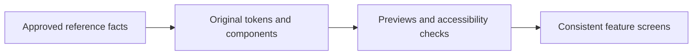
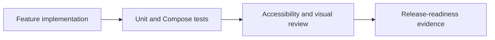
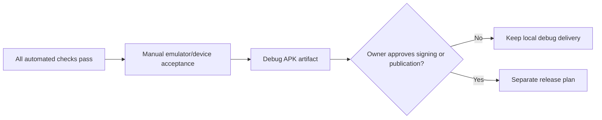

# GOALS — Pierre-inspired Android finance companion

**Execution status:** in progress. This plan authorizes only an offline Android demonstration with fictional financial data, not bank access, publication, or production signing.

## Product decision recorded

Build a **greenfield, native Android demo** inspired by Pierre's financial overview, conversational assistance, and proactive insights, under the user's own **ALLU ERP identity**. On 23 September 2026 the user authorized reuse of the ALLU symbol, colors, and style. The working app label is **ALLU Finanças**; final release name and package identifier remain pending. Do not copy Pierre assets, brand, or text.

The first release is an **offline, fictional-data APK**. It must not ask for banking credentials, connect to Open Finance, claim a banking partnership, trigger WhatsApp, perform payments, make investment recommendations, or describe sample information as live financial data. This keeps the requested visual/interaction prototype achievable without handling regulated or sensitive financial data.

The user chose an original presentation based on ALLU ERP instead of Pierre screenshots. Use the ALLU mark and brand tokens from `D:\ProjetosPessoais\ERP\frontend\public\images\logo` and `frontend\src\app\globals.css` as reference; record source paths and adapt the system to Android. Final visual acceptance requires a rendered Android build reviewed by the owner.

## Evidence and constraints used for this plan

- `REPERTOIRE.md` documents the public Pierre catalog: Open Finance aggregation, conversations through app/web/WhatsApp, agents, budget/reporting, a CDB offering, and the future Pierre One/Computer products.
- Pierre’s public terms describe the service as informational support rather than professional financial, investment, legal, accounting, or tax advice. This plan preserves that boundary.
- Android’s current official guidance is Compose-first, recommends screen-level `ViewModel` plus `StateFlow`, and provides first-party Compose UI tests. [Compose-first](https://developer.android.com/develop/ui/compose/first) · [architecture](https://developer.android.com/topic/architecture/recommendations) · [Compose testing](https://developer.android.com/develop/ui/compose/testing)
- For new Google Play submissions after 31 August 2026, Google’s current policy requires target Android 16 / API 36 or higher. The target must be rechecked just before any release. [Google Play policy](https://support.google.com/googleplay/android-developer/answer/11926878)
- Android’s security guidance requires least privilege and keeping sensitive information out of shared/external storage. The MVP contains no real financial data; this rule remains mandatory if the scope ever expands. [Android security checklist](https://developer.android.com/privacy-and-security/security-tips)

## Out of scope for this plan

- Copying or impersonating Pierre, CloudWalk, InfinitePay, any bank, or WhatsApp.
- Real Open Finance, payment initiation, card issuance, brokerage/CDB execution, background financial monitoring, or a production chatbot.
- User accounts, cloud sync, analytics, advertising SDKs, personal data collection, remote API keys, and Google Play publication.
- iOS, web, smartwatch, shared-family accounts, and multi-currency operation.

# GOALS 3 — Build the ALLU Finanças design system before screens

Suggested: gpt-5.6-sol · high — visual fidelity depends on many interacting layout, typography, state, and motion decisions rather than a single screen implementation.

- [x] G3.1 — Implement ALLU-derived tokens for color, elevation, spacing, corner radius, typography, icon sizing, motion, and semantic states (success, warning, critical, neutral). Use accessible contrast, reuse the user-authorized ALLU mark, and do not reproduce Pierre’s assets or text. **Done when:** tokens power every component preview and a light/dark decision is intentional; the default demo mode uses the approved ALLU navy theme.
- [x] G3.2 — Create reusable Compose components: app scaffold, greeting/header, amount row, status pill, transaction row, insight card, chart container, assistant bubble, loading skeleton, error notice, empty state, bottom navigation, and confirmation sheet. **Done when:** each component has normal, loading, empty, error, and disabled states where relevant, plus `contentDescription`/semantics when it conveys information.
- [x] G3.3 — Define motion tokens with a reduced-motion preference: brief press feedback, list/card entry, number transition, and sheet movement, all interruptible and optional. Avoid decorative animation that delays a financial value or status. **Done when:** animations respect a disabled/reduced-motion setting and no screen relies on motion alone to communicate state.
- [ ] G3.4 — Produce Compose previews for 360dp and 412dp phones, large font, dark mode, empty/loading/error states, and a long Portuguese currency value. **Done when:** no important amount, label, action, or navigation control clips in the specified previews.
- [ ] G3.5 — Perform a manual comparison against the owner-approved screenshots and record differences as intentional original-brand decisions or defects. **Done when:** the owner signs off on a side-by-side state-by-state comparison; source/build success alone is not accepted as visual proof.

# GOALS 7 — Establish quality, accessibility, and privacy proof

Suggested: gpt-5.6-sol · high — regression proof must cover calculation rules, state restoration, navigation, and accessible financial information rather than only a successful build.

- [x] G7.1 — Add unit tests for repositories, budget calculations, category correction, alert rules, assistant intent parsing, unsupported-intent response, and reset behavior using fakes rather than external services. **Done when:** all calculations have representative normal, boundary, empty, and invalid-state assertions.
- [x] G7.2 — Add Compose UI tests for onboarding disclosure, dashboard period change, transaction filtering/detail, budget update, alert dismissal/reopen, assistant supported/unsupported prompt, settings persistence, and reset confirmation. **Done when:** the instrumented suite passes on the documented emulator/API level.
- [ ] G7.3 — Add screenshot/regression testing only after the owner approves the ALLU Finanças visual baseline; never place Pierre screenshots or assets in test fixtures. **Done when:** approved Android screenshots cover dashboard, transaction list, assistant, large font, and dark-mode edge cases.
- [ ] G7.4 — Audit TalkBack semantics, focus order, touch target size, dynamic type, color contrast, localized Brazilian currency/date formatting, no-color-only warning states, and reduce-motion behavior. **Done when:** manual TalkBack walkthrough and automated semantics checks pass for every bottom-navigation destination.
- [x] G7.5 — Run dependency, secret, and permission reviews: no network permission unless an approved later feature needs it; no storage/contact/SMS/phone permission; no analytics; no tracked personal data; no hard-coded key. **Done when:** manifest and dependency review confirm the permission/data-minimization policy and any exception has an owner-approved reason.
- [ ] G7.6 — Configure one repeatable local/CI-quality command sequence for formatting, static analysis, unit tests, instrumented tests, and debug APK assembly. **Done when:** commands return meaningful non-zero failures and are documented in the README.

# GOALS 8 — Produce the APK and retain human release gates

Suggested: gpt-6-astra · xhigh — APK signing, distribution, developer verification, and any financial-data expansion are external, security-sensitive approval gates.

- [ ] G8.1 — Assemble a debug APK after all quality checks pass; record its application ID, version name/code, SHA-256 checksum, build command, and tested device/emulator API level. **Done when:** the artifact installs and the complete MVP acceptance flow is manually exercised on a physical device or Android emulator.
- [ ] G8.2 — Perform a manual visual acceptance against the ALLU ERP identity and approved Android baseline at the recorded device size. **Done when:** the owner confirms that the ALLU symbol, color/style continuity, clarity, information density, and conversation-led flow are achieved without Pierre branding.
- [ ] G8.3 — Keep release signing, developer identity verification, Play Console setup, store listing, privacy/data-safety declarations, support channel, terms, and publication **out of execution** until separately authorized. **Done when:** release work has its own approved plan, signing key custody owner, and verified current Google/Android policy requirements.
- [x] G8.4 — Do not add real Open Finance or WhatsApp capability without a separate human-in-the-loop discovery and compliance plan covering provider contracts, consent flow, backend security, LGPD roles, incident response, authentication, data deletion/export, financial disclosures, and end-to-end device testing. **Done when:** no code for these integrations has been started under the demo scope.

## Execution order

1. G1 locks the scope, legal/brand limits, original identity, and visual references.
2. G2 makes the Android project reproducible.
3. G3 establishes components and visual acceptance before duplicating screen code.
4. G4 supplies deterministic local data and state.
5. G5 ships the complete, navigable demo.
6. G6 adds differentiated trust and explainability improvements.
7. G7 proves behavior, privacy, accessibility, and visual quality.
8. G8 produces only a debug APK, retaining signing/publication/integration as explicit human approval gates.

## Manual decisions still required before a production release

- The first deliverable is the offline fictional-data debug APK requested here. Real integrations need a separate authorization and plan.
- Confirm the final release name and package ID; the prototype uses “ALLU Finanças” and `com.example.allufinancas` provisionally.
- Review the installed Android screens against the ALLU ERP colors and symbol; owner visual acceptance is still pending.
- Decide later whether to commission a signed internal release. No signing or publication is authorized in this execution.

## Improvement backlog after the MVP

These are product opportunities, not authorized implementation:

1. **Financial data freshness and coverage:** show last successful sync, accounts excluded from a conclusion, and source-level confidence on all insights.
2. **Reconciliation before automation:** let users approve category, merchant and duplicate decisions, with full reversal history.
3. **Explainable simulations:** make every budget scenario reveal arithmetic, assumptions, time period, and what it cannot predict.
4. **Trust center:** one place to inspect permissions, data origins, connected institutions, consent expiry/revocation, deletion/export status, and support contact.
5. **Collaborative budgeting:** a later, consentful household mode with separate identities and clear ownership, instead of shared credentials.
6. **Proactive alerts with restraint:** user-configured thresholds, quiet hours, grouping, and a clear reason for each message rather than high-volume notifications.
7. **Human escalation:** when an insight crosses into tax, legal, credit, investment, fraud, or debt advice, stop at factual explanation and direct the user to an appropriate qualified professional/channel.

## Explicit success definition

The work is complete only when an original-name Android app installs as a debug APK, uses exclusively fictional local data, performs the documented navigation/calculation/demo-chat flows, passes the defined static/unit/UI tests, meets accessibility checks, and has passed owner-approved visual comparison. It is **not** complete merely because the code compiles, and it does not include banking, payment, WhatsApp, card, investment, signing, or store-publication functionality.
