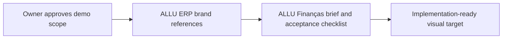

# GOALS 1 — Lock the original product brief and reference boundaries

Suggested: gpt-6-astra · xhigh — the main risk is avoiding brand/trade-dress confusion while defining a finance-like experience with correct product claims.

- [x] G1.1 — Create `README.md` that declares ALLU Finanças as a fictional, offline Android demonstration, identifies final release name/package as pending, and lists the exact build/run commands. **Done when:** a new developer can follow the README from an empty checkout without assuming a real financial integration.
- [x] G1.2 — Record the owner's ALLU identity, Brazilian Portuguese, and debug APK decisions; keep the final release package identifier explicitly pending. **Done when:** these choices and their provisional/release distinction are written in `README.md` or `PRODUCT.md`.
- [x] G1.3 — Inventory the user-authorized ALLU ERP symbol, wordmark, color tokens, font, and representative UI structure from ERP source; record exact reference paths and layout facts. **Done when:** each selected brand asset/token has provenance and the Android UI brief identifies how it will be adapted without copying Pierre assets.
- [x] G1.4 — Translate the ALLU identity into a native Android visual brief: navy/indigo brand hierarchy, high-contrast numerical hierarchy, compact financial summaries, conversational cards, and restrained motion. **Done when:** the brief names the ALLU sources and the finance interaction patterns separately.
- [x] G1.5 — Define the MVP acceptance flows: first launch, dashboard scan, filter transactions, inspect an insight, ask a supported assistant question, create/change budget, dismiss/reopen an alert, and reset demo data. **Done when:** every flow has a user action, expected visible result, empty/error state, and accessibility expectation.

