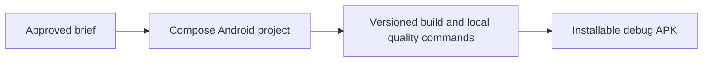

# GOALS 2 — Establish a reproducible native Android foundation

Suggested: gpt-5.6-terra · medium — this is conventional Android setup with a high value on reproducibility and a small dependency surface.

- [x] G2.1 — Initialize one Kotlin Android application with Gradle wrapper, version catalog, `app` module, Compose, Material 3, Kotlin coroutines, lifecycle-aware state collection, Navigation Compose, Room, DataStore, and a minimal dependency-injection approach. Prefer constructor injection unless a concrete need justifies Hilt. **Done when:** a clean checkout builds via the documented Gradle command with no globally installed dependency other than the Android SDK/JDK prerequisites.
- [x] G2.2 — Configure `compileSdk`/`targetSdk` to API 36 or the current Google Play requirement at execution time; set `minSdk` deliberately after testing the intended device range (proposed initial floor: API 26). Pin compatible Kotlin, AGP, Compose BOM, and JDK versions in the version catalog. **Done when:** the build prints the selected API levels and a CI/local validation rejects an accidentally lower target SDK.
- [x] G2.3 — Create a single-activity app with explicit packages for `core`, `designsystem`, `data`, `feature`, and `navigation`; do not create speculative clean-architecture layers beyond these needs. **Done when:** each initial screen can be located by feature and reusable UI primitives live only in `designsystem`.
- [x] G2.4 — Add `.gitignore` for Android/Gradle/IDE outputs and `.env.example` only if a future integration needs configuration. Do not create a real `.env`, keystore, API key, or token. **Done when:** a repository scan shows no generated build output, local IDE metadata, signing key, or secret is tracked.
- [x] G2.5 — Define `debug` as the only active build variant; add a clearly labeled future `release` signing checklist but do not generate or store a keystore. **Done when:** the debug APK installs on an emulator/device and the README explains that it is not a production-signed financial application.
