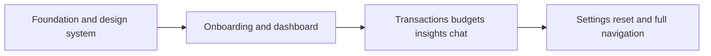

# GOALS 5 — Implement the complete MVP navigation and screens

Suggested: gpt-5.6-sol · high — this is a multi-screen mobile experience whose quality depends on coherent state, navigation, and visual detail.

- [x] G5.1 — Build welcome/onboarding screens that explain the offline demo, show no bank-login lookalike, ask no unnecessary runtime permission, and offer “Explore demo” plus “Privacy and demo data” links. **Done when:** a first-time user can reach the dashboard without entering personal data and can identify the demo nature before seeing a balance.
- [x] G5.2 — Build a dashboard with ALLU Finanças branding: total fictional balance, account summary, income/expense period selector, category breakdown, recent transactions, goal/budget status, and a ranked insight feed. **Done when:** all values react consistently to selected period and the dashboard has correct loading, empty, and error presentation.
- [x] G5.3 — Build transaction list and transaction detail with search, category filter, date/range filter, clear source/freshness/demo label, merchant/category/value/date/installment fields, and category correction action. **Done when:** filtered results, detail navigation, and edit persistence are covered by automated tests.
- [x] G5.4 — Build budgets and goals: category limit, progress, overage warning, editable amount, reset action, and explanation of the fictional calculation. **Done when:** changing a demo budget immediately updates dashboard and assistant calculations, with a clear confirmation before destructive reset.
- [x] G5.5 — Build insights and alert inbox: duplicate-charge warning, recurring subscription, unusual spend, budget threshold, and all-clear state. Provide severity, source/rule, generated date, dismiss/reopen behavior, and a no-advice disclaimer. **Done when:** each alert is explainable from local data and no alert implies a bank fraud finding or investment recommendation.
- [x] G5.6 — Build assistant conversation screen with suggested questions, clear local-answer indicator, typed messages, answer citations to on-device demo transactions/categories, and unsupported-question handling. **Done when:** accessibility services can read the conversation in order and no response fabricates external/live data.
- [x] G5.7 — Build settings/privacy screen with theme, reduce motion, currency format, data disclosure, reset demo data, and a “How real integrations would work” educational page. **Done when:** settings persist locally and reset requires a confirmation with its exact impact.
- [x] G5.8 — Implement bottom navigation, back-stack behavior, deep-link-safe route arguments, state restoration, and adaptive layout for phone portrait/landscape. **Done when:** main flows work through navigation controls and state remains understandable after rotation or process recreation.
