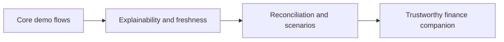

# GOALS 6 — Add the product improvements that make the concept safer and more useful

Suggested: gpt-6-astra · xhigh — improvements that resemble financial assistance must preserve user control and avoid accidental advice, payment, or data-privacy claims.

- [x] G6.1 — Add a **data provenance strip** to every financial summary: “demo data,” source, generated time, and calculation scope. Design the component so a future real integration can expose last-sync time and incomplete account coverage. **Done when:** every primary finance screen shows why the number should be trusted and what it excludes.
- [x] G6.2 — Add a **reconciliation inbox** that lists uncategorized, possible duplicate, and suspicious-looking demo transactions, with confidence/rule explanations and explicit user decisions. **Done when:** changing an item is reversible and does not silently alter the original transaction amount/date.
- [x] G6.3 — Add a **what-if budget scenario** that lets the user alter a fictional category/goal and shows the transparent arithmetic, assumptions, and reset path. It must not forecast investment return, credit approval, or personal eligibility. **Done when:** all scenario results can be recomputed from local values and are labeled simulation.
- [x] G6.4 — Add a **plain-language financial health summary** focused on observable signals — recurring commitments, budget pressure, and upcoming installments — with links to underlying demo data. **Done when:** every statement carries an explanation and a neutral next action, not a prescriptive investment/credit recommendation.
- [x] G6.5 — Add a **privacy-first export/delete concept** only as UI documentation in this offline release; do not expose raw demo DB files or external storage. **Done when:** the UI explains that the data is local demo data, export is unavailable in the MVP, and reset clears only the app’s fictional local records.

## Completion evidence — 2026-09-29

- G6.1: provenance is shown across primary finance screens, with the local materialization timestamp separated from the editorial package date. Optional sync/coverage fields render only when supplied. Repository and Compose tests passed.
- G6.2: the review inbox covers an uncategorized sample, a possible duplicate, and an unusual amount. Decisions are stored locally and reversible; category changes are overlays, the source amount/date/category remain intact, duplicate decisions do not remove records, reset clears decisions transactionally, and Room v1→v2 migration is tested.
- G6.3: the budget scenario recalculates from local September 2026 demo values, explicitly shows the equation and difference from the configured limit, stays in screen state, and does not call the persistence/update path. Activity recreation and reset behavior are tested.
- G6.4: Home exposes only observed recurring markers, category-limit overruns, and remaining installments from recorded counters. Each signal explains its rule and links to source transactions or Plans; completed installments such as 10/10 are excluded. No score or forecast is produced.
- G6.5: onboarding and Settings explain local fictional finance data, potentially non-fictional chat input, unavailable export/individual deletion, and the app-local scope of restoring the demo. Tests cover both privacy entry points, cancellation, reset, and preserved preferences.
- Integrated verification: `:app:testDebugUnitTest` passed 30 tests; `:app:connectedDebugAndroidTest` passed 22/22 on the emulator with no skips; `:app:lintDebug` passed; `:app:assembleDebug` passed.
- Owner visual approval remains open under G3.4, G3.5, and G8.2; automated checks and the debug build do not substitute for that review.
